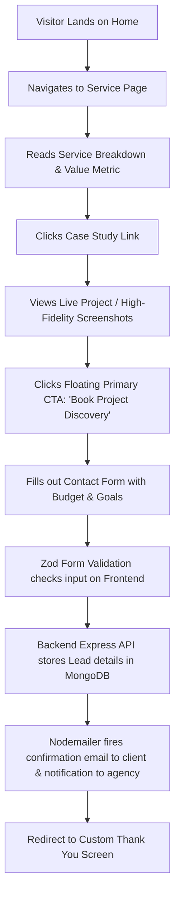
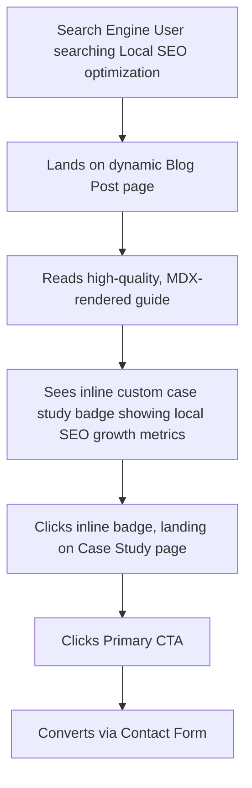

# Creovix Stack: Comprehensive System Documentation

## Table of Contents
1. [Executive Summary](#1-executive-summary)
2. [Company Vision](#2-company-vision)
3. [Mission](#3-mission)
4. [Brand Positioning](#4-brand-positioning)
5. [Unique Selling Proposition](#5-unique-selling-proposition)
6. [Business Goals](#6-business-goals)
7. [Target Audience Personas](#7-target-audience-personas)
8. [Competitor Analysis](#8-competitor-analysis)
9. [SWOT Analysis](#9-swot-analysis)
10. [Complete Website Sitemap](#10-complete-website-sitemap)
11. [Information Architecture](#11-information-architecture)
12. [User Flow](#12-user-flow)
13. [Navigation Structure](#13-navigation-structure)
14. [Complete Page List](#14-complete-page-list)
15. [Every Page Description](#15-every-page-description)
16. [Sections Inside Every Page](#16-sections-inside-every-page)
17. [Call To Action Strategy](#17-call-to-action-strategy)
18. [Complete Content Strategy](#18-complete-content-strategy)
19. [Portfolio Structure](#19-portfolio-structure)
20. [Case Study Structure](#20-case-study-structure)
21. [Blog Strategy](#21-blog-strategy)
22. [SEO Strategy](#22-seo-strategy)
23. [Keyword Strategy](#23-keyword-strategy)
24. [Metadata Strategy](#24-metadata-strategy)
25. [Schema Markup Plan](#25-schema-markup-plan)
26. [Technical Architecture](#26-technical-architecture)
27. [Folder Structure](#27-folder-structure)
28. [Database Collections](#28-database-collections)
29. [Database Schema](#29-database-schema)
30. [API Documentation](#30-api-documentation)
31. [Authentication Flow](#31-authentication-flow)
32. [Contact Form Flow](#32-contact-form-flow)
33. [Lead Management Flow](#33-lead-management-flow)
34. [Newsletter Flow](#34-newsletter-flow)
35. [Image Optimization Strategy](#35-image-optimization-strategy)
36. [Performance Strategy](#36-performance-strategy)
37. [Accessibility Plan](#37-accessibility-plan)
38. [Security Plan](#38-security-plan)
39. [Analytics Events](#39-analytics-events)
40. [Error Handling](#40-error-handling)
41. [Reusable Components](#41-reusable-components)
42. [Design System](#42-design-system)
43. [Typography](#43-typography)
44. [Color Palette](#44-color-palette)
45. [Spacing System](#45-spacing-system)
46. [Animation Guidelines](#46-animation-guidelines)
47. [Responsive Design Rules](#47-responsive-design-rules)
48. [Micro Interactions](#48-micro-interactions)
49. [Forms](#49-forms)
50. [Buttons](#50-buttons)
51. [Cards](#51-cards)
52. [Icons](#52-icons)
53. [Loading States](#53-loading-states)
54. [Empty States](#54-empty-states)
55. [404 Page](#55-404-page)
56. [Maintenance Page](#56-maintenance-page)
57. [Privacy Policy Structure](#57-privacy-policy-structure)
58. [Terms Structure](#58-terms-structure)
59. [Future Phase 2 Expansion Plan](#59-future-phase-2-expansion-plan)
60. [Development Roadmap](#60-development-roadmap)
61. [Development Milestones](#61-development-milestones)
62. [Testing Checklist](#62-testing-checklist)
63. [Deployment Checklist](#63-deployment-checklist)
64. [Post Launch Checklist](#64-post-launch-checklist)
65. [Future Feature Ideas](#65-future-feature-ideas)
66. [AI Development Prompt Roadmap](#66-ai-development-prompt-roadmap)

---

## 1. Executive Summary
Creovix Stack is a premium freelance software development agency specializing in elite-tier digital experiences. The agency bridges the gap between high-level engineering and sophisticated design. This documentation details the core specifications for the Phase 1 launch of the Creovix Stack agency website. Built using a modern technical stack—Next.js 15, React 19, Tailwind CSS v4, and Node.js/Express with MongoDB Atlas—the site will demonstrate the company's technical acumen while serving as a high-conversion lead generation engine. 

---

## 2. Company Vision
To establish Creovix Stack as the global benchmark for design-forward, technically superior bespoke software engineering. We envision a future where companies partner with Creovix Stack not merely to build websites, but to construct fast, accessible, secure, and search-dominant assets that directly impact their valuation and bottom line.

---

## 3. Mission
To deliver premium, engineered digital solutions by demystifying complex technical architecture, executing flawless software quality assurance, and implementing aggressive, data-backed search engine optimization strategies. We commit to radical transparency, using zero templates, and writing modular, tested code that stands the test of size and traffic.

---

## 4. Brand Positioning
Creovix Stack sits at the intersection of **Luxury Aesthetics** and **Industrial-Grade Software Engineering**. 
Unlike mass-market agency models that rely on slow page builders or copy-pasted landing page templates, Creovix Stack positions itself as an elite boutique. We leverage a minimal design philosophy, deep technical performance metrics, and a clean typography system to command premium pricing from startups, established local businesses, and corporate teams.

---

## 5. Unique Selling Proposition
> **"Bespoke High-Performance Architectures. Zero Builders. 100% Tested. Engineered for Growth."**
Our USP combines custom Next.js 15 React architecture with professional QA testing pipelines and deep technical SEO audits as native parts of our delivery process. We build digital assets that launch with clean code, are completely verified by testing suites, and rank natively due to optimized page structures.

---

## 6. Business Goals
1. **Lead Generation:** Secure 30 to 45 high-quality, verified project inquiries per month within 180 days of launch.
2. **Authority & Validation:** Establish industry-wide technical authority by showcasing detailed Case Studies detailing performance graphs, test code snippets, and quantifiable business revenue metrics.
3. **Optimized Conversion:** Achieve a site-wide visitor-to-lead conversion rate of 3.5% through clear call-to-actions, minimalist forms, and zero visual friction.
4. **Organic Search Growth:** Achieve first-page rankings for key localized and service-specific queries (e.g., "MERN Stack developers near me", "professional software testing services") within 6 months.
5. **Technical Excellence:** Maintain a consistent Google Lighthouse score of 98+ on mobile and desktop devices.

---

## 7. Target Audience Personas

### Persona A: Sarah, The VC-Backed Startup Founder
* **Demographics:** Age 32, Silicon Valley / Remote, Tech-savvy, High Capital.
* **Core Goal:** Launch a responsive MVP (Minimum Viable Product) to showcase to series-A investors within a strict 6-week timeframe.
* **Pain Points:** Disappointed by previous freelancer agencies who delivered buggy, slow, and unscalable WordPress/No-Code mockups.
* **Decision Factors:** Demands code control, technical documentation, API modularity, and Next.js performance speed.

### Persona B: David, Local Service Business Owner
* **Demographics:** Age 45, Regional Business Hub, Non-technical, Established local presence.
* **Core Goal:** Modernize an outdated business website to drive online bookings and rank higher in local search results.
* **Pain Points:** Confused by developers throwing tech jargon. Needs someone to handle updates, backups, local SEO, and maintenance.
* **Decision Factors:** Clear pricing packages, local SEO dominance, mobile accessibility, and responsive support.

### Persona C: Elena, Agency Director / Outsource Manager
* **Demographics:** Age 38, London, Design Agency owner.
* **Core Goal:** Partner with an external development boutique to handle frontend Next.js builds and independent software testing.
* **Pain Points:** Internal designers build beautiful mockups, but internal devs struggle to implement clean CSS/React states and fail to test across browsers.
* **Decision Factors:** Flawless pixel alignment, cross-device execution, and organized manual/automation testing reporting.

---

## 8. Competitor Analysis

| Competitor Type | Competitor Characteristics | Creovix Stack Advantage |
| :--- | :--- | :--- |
| **Traditional Web Agencies** | Use heavy WordPress page builders (Elementor/Divi), slow hosting, lack version control. | Next.js 15 Static Site Generation (SSG) with Sub-second loading speeds and strict Tailwind CSS structure. |
| **Boutique Design Studios** | Excel at UI/UX design, but lack custom backend development capabilities and testing verification. | Complete full-stack custom engineering capabilities (MERN stack) with comprehensive QA manual/automated test logs. |
| **Mass Freelance Marketplaces** | High noise ratio, language barriers, zero post-launch maintenance packages. | Professional corporate structure, clear SLA contracts, structured technical architecture, and premium monthly support. |

---

## 9. SWOT Analysis

### Strengths
- Expertise in modern technologies: Next.js 15, React 19, Tailwind CSS v4, Express, and MongoDB.
- Native integration of professional testing methodologies (Manual & Automation) as a core offering.
- Premium minimal design direction matching SaaS giants (Stripe, Linear).

### Weaknesses
- Higher initial cost structure compared to template-based developers.
- Phase 1 excludes native mobile apps and advanced AI integrations, limiting initial audience reach.

### Opportunities
- Growing business migration from bloated platforms (legacy WordPress, Shopify layouts) to headless architectures.
- High market demand for local business owners seeking optimization for Google Business Profiles and local SEO.

### Threats
- Low-cost AI generators that make basic websites cheap, which we counter by positioning ourselves as bespoke system architects rather than template builders.

---

## 10. Complete Website Sitemap

```
/ (Home Page)
├── /services (Services Directory)
│   ├── /services/web-development (Full Stack Web Development)
│   ├── /services/wordpress-development (WordPress Development Services)
│   ├── /services/software-testing (Software QA & Testing Services)
│   ├── /services/seo (Search Engine Optimization)
│   └── /services/website-maintenance (Website Maintenance & Support)
├── /portfolio (Portfolio Overview)
│   └── /portfolio/[slug] (Dynamic Case Studies)
├── /blog (Blog Directory)
│   └── /blog/[slug] (Dynamic MDX Articles)
├── /about (About Us)
├── /contact (Contact & Lead Form)
├── /admin (Secure CRM Lead Dashboard)
│   └── /admin/subscribers (Newsletter management)
├── /maintenance (Maintenance Mode Page)
└── /404 (Custom Not Found Page)
```

---

## 11. Information Architecture
* **Top-Level Navigation:** Core conversion pillars (Services, Portfolio, Blog, About, Contact).
* **Cross-Linking System:** Each service page contains dynamically pulled portfolio items filtered for that service, alongside relevant educational blog entries.
* **Semantic Hierarchy:** URL routes follow a clean nested model `/services/web-development` rather than parameterized structures.
* **Footer Foundation:** Contains secondary site structures, including policy agreements, specific services, office location metadata, and a quick newsletter entry form.

---

## 12. User Flow

### 12.1 The Lead Conversion Flow


### 12.2 The Blog Reader Flow


---

## 13. Navigation Structure
* **Desktop Navigation:** Sticky layout with a height of `64px`. Uses a glassmorphic background layer (`backdrop-blur-md bg-slate-950/75`). Features custom animatable dropdown menus for the 5 primary Phase 1 services. Includes a prominent, primary CTA button on the far right.
* **Mobile Navigation:** Animated hamburger toggle transition (converts to 'X' state). Slides open a full-height screen overlay (`fixed inset-0 z-50 bg-slate-950/95`). Standard lists display all core routes using large typography targets (`text-2xl`), ending in a full-width CTA link button at the bottom.

---

## 14. Complete Page List
1. **Home Page (`/`)**: Main entry portal. Establishes brand design, services, and trust markers.
2. **Services Overview Page (`/services`)**: Comprehensive directory detailing the five Phase 1 service verticals.
3. **Full Stack Web Development Details (`/services/web-development`)**: Specific deep-dive on MERN stack, custom web apps, and performance features.
4. **WordPress Development Details (`/services/wordpress-development`)**: Focuses on theme customization, WooCommerce platforms, and migrations.
5. **Software Testing Details (`/services/software-testing`)**: Deep breakdown of automated and manual QA services.
6. **SEO Details (`/services/seo`)**: Covers technical site performance, local search visibility, and keyword architecture.
7. **Website Maintenance Details (`/services/website-maintenance`)**: Outlines security plans, monthly maintenance schedules, and server checks.
8. **Portfolio Index (`/portfolio`)**: Filters case study cards by primary service.
9. **Dynamic Case Study Details (`/portfolio/[slug]`)**: Rich, data-focused metrics, layouts, and system diagrams for each project.
10. **Blog Index (`/blog`)**: Displays blog posts sorted by category. Includes pagination and a search search bar.
11. **Dynamic Blog Post (`/blog/[slug]`)**: Renders MDX files, code snippet blocks, and conversion buttons.
12. **About Us (`/about`)**: Background, processes, philosophy, and tech values.
13. **Contact (`/contact`)**: Multi-step interactive lead form.
14. **Admin Lead Dashboard (`/admin`)**: Secure interface to manage incoming clients and newsletter lists.
15. **Maintenance Fallback (`/maintenance`)**: Clean layout for scheduled maintenance windows.
16. **404 Page (`/404`)**: Catch-all page with clean redirection routes.

---

## 15. Every Page Description

### Home Page
A high-end, clean portal introducing Creovix Stack. Focuses on premium typography, smooth Framer Motion animations, and a showcase of key metrics (load times, project counts, bug reduction rates).

### Services Overview
An organized directory page detailing the five operational services. Avoids long paragraphs, opting for grid systems displaying concrete deliverables, pricing baselines, and quick links.

### Web Development Page
Designed for startups and product teams. Highlights the advantages of Next.js 15 static generation, React 19 Server Components, and the speed metrics of headless MERN systems.

### WordPress Page
Addresses business owners who need flexible content systems. Emphasizes clean theme structures, secure plugins, performance optimization, and WooCommerce setup.

### Software Testing Page
Targeted at agencies and developers. Shows code-level automation snippets, cross-browser testing matrices, and visual reporting styles.

### SEO Page
Highlights our search engine performance offerings. Outlines our approach to technical audits, keyword research, Core Web Vitals, and Google Business profile strategies.

### Maintenance Page
Outlines our support plans. Explains database backup structures, uptime monitoring, security patching, and bug fixes.

### Portfolio Index
A grid showcase of executed works. Features fast, client-side filtering powered by TanStack Query, showing cards with visual tags, metrics, and technology badges.

### Dynamic Case Study
A structured analysis of a specific client project. Includes performance charts, challenges faced, strategies deployed, and final outcomes.

### Blog Index
A directory of insights. A search-optimized list displaying featured articles, category selectors, and search fields.

### Dynamic Blog Page
A content-focused page optimized for readability. Uses large serif/sans-serif hierarchies, custom code syntax highlights, and contextual callouts.

### About Page
Focuses on the team's engineering practices, core values, quality standards, and commitment to custom design architectures.

### Contact Page
A minimalist page featuring a styled contact form. Designed to capture client requirements, budgets, timeline targets, and technical goals without friction.

### Admin Dashboard
A secure workspace for lead management. Displays table rows showing incoming leads, custom status badges, details, and CSV export tools.

### Maintenance Fallback Page
A clean, static fallback shown during deployments. Explains why the site is offline and offers an email option.

### 404 Page
Handles incorrect links. Keeps users on the site by offering links to the home page, services, and portfolio pages.

---

## 16. Sections Inside Every Page

### 16.1 Home Page
1. **Hero Section:** Minimal typography header, tagline, supporting subtext, double CTA buttons (Primary: "Initiate Discovery", Secondary: "Explore Engineering portfolio").
2. **Key Metric Banner:** Client stats (e.g., 99.9% Uptime, <1.2s average load time, 100% Client satisfaction rate).
3. **Phase 1 Services Grid:** Cards detailing the five core services with subtle hover micro-interactions.
4. **Featured Portfolio Slider:** Sliding list of case studies.
5. **Interactive Architecture Showcase:** A visual component showing our custom Next.js/Express system workflow.
6. **Client Testimonials Grid:** High-quality reviews from startups and small business owners.
7. **Dynamic Blog Highlights:** The three most recent educational articles.
8. **Footer Conversion Panel:** Large footer banner encouraging project inquiries.

### 16.2 Services Overview Page
1. **Header Section:** Dynamic title and introduction.
2. **Service Vertical Cards:** Detailed rows for each service, showing deliverables, core tech badges, and a direct CTA link.
3. **Our Process Accordion:** Interactive steps showing our development process (Discovery, Architecture, Quality Assurance, SEO, Launch).
4. **Final Conversion Section:** Link to the contact form.

### 16.3 Web Development Details Page
1. **Hero Section:** Focuses on custom Next.js development.
2. **Tech Capabilities Stack:** Icons and technical details of MERN, TypeScript, and Tailwind CSS.
3. **Core Deliverables Grid:** List of custom deliverables (e.g., custom admin dashboards, headless checkout, clean integrations).
4. **Specific Case Studies Grid:** Shows selected web development case studies.
5. **FAQ Accordion:** Answers about cost, timelines, code ownership, and frameworks.

### 16.4 WordPress Details Page
1. **Hero Section:** Focuses on premium, custom-coded WordPress setups.
2. **Service Options Grid:** Lists options like WooCommerce, theme customization, and migrations.
3. **Optimization Matrix:** Visual comparison of default builders vs. our custom WordPress setups.
4. **Testimonials Panel:** Short reviews from WordPress clients.

### 16.5 Software Testing Details Page
1. **Hero Section:** Focuses on quality assurance and bug reduction.
2. **Testing Capabilities Grid:** Outlines manual testing, automation, functional, regression, cross-browser, and mobile testing.
3. **Sample Test Case:** Custom UI snippet showing a Cypress/Playwright automation script.
4. **Reporting Interface Mock:** Shows sample bug reports and test plans.

### 16.6 SEO Details Page
1. **Hero Section:** Focuses on search ranking improvements.
2. **SEO Capabilities Grid:** Covers technical, on-page, local, audits, and keywords.
3. **SEO Growth Case Study:** Visual breakdown of search traffic improvements.
4. **SEO Audit CTA Banner:** Form field for a free technical website speed audit.

### 16.7 Website Maintenance Page
1. **Hero Section:** Focuses on security and performance support.
2. **Service Details Grid:** Outlines updates, optimizations, backups, fixes, and content additions.
3. **Maintenance Plans Table:** Pricing and tier details.
4. **FAQ Section:** Maintenance-specific questions.

### 16.8 Portfolio Index
1. **Header Section:** Overview of completed projects.
2. **Interactive Filters Menu:** Toggle options (All, Web Dev, WordPress, QA, SEO).
3. **Case Study Grid:** Dynamically filtered cards with key metrics and tech tags.
4. **CTA Banner:** Banner asking "Ready to build your system?"

### 16.9 Dynamic Case Study
1. **Hero Section:** Visual presentation of the project, including client name, category, and tagline.
2. **Key Metric Blocks:** Displays outcomes (e.g., "+150% Sales Conversion", "-60% Page Load Time").
3. **The Challenge:** Text explaining the client's problem.
4. **Architecture Diagram:** Mermaid-style visualization of the system design.
5. **The Solution:** Breakdown of how the system was designed, built, and tested.
6. **Outcome & Deliverables:** Bullet points listing deliverables.
7. **Client Testimonial:** Quote from the client.
8. **More Work Gallery:** Carousel links to other case studies.

### 16.10 Blog Index
1. **Hero Section:** Overview of insights.
2. **Featured Post Card:** Large display of the latest post.
3. **Category Selector & Search Bar:** Interactive filters.
4. **Dynamic Article Grid:** Clean cards with read-time indicators.
5. **Newsletter Form:** Inline subscription box.

### 16.11 Dynamic Blog Page
1. **Header:** Title, author, date, category tag, and read time.
2. **MDX Content Area:** Renders typography, blockquotes, lists, and code blocks.
3. **Inline Lead Banner:** Middle-of-article CTA.
4. **Article Share Panel:** Quick share buttons.
5. **Related Posts:** Three related articles.

### 16.12 About Page
1. **Hero Section:** Introduction to our team and philosophy.
2. **Core Values Grid:** Details our focus on clean code, transparent processes, performance metrics, and custom design.
3. **Our Tech Stack Matrix:** Icons showing our frontend and backend tech choices.
4. **Workflow Visual:** Steps of our client engagement process.
5. **CTA Section:** Link to book a discovery call.

### 16.13 Contact Page
1. **Hero Section:** Clear title and support details.
2. **Interactive Lead Form:** Multi-step form with validation.
3. **Contact Details Grid:** Email address, local business phone number, and physical office address.
4. **FAQ panel:** Direct answers to common questions about starting a project.

### 16.14 Admin Dashboard Page
1. **KPI Stats Grid:** Total leads, conversion rate, newsletter subscribers.
2. **Leads Table:** Displays name, company, service request, budget, date, and status.
3. **Lead Detail Modal:** Full view of form data and status updater.
4. **Newsletter Subscribers Table:** Displays emails, subscription status, and date.
5. **System Settings:** Controls for maintenance mode toggle.

### 16.15 Maintenance Fallback Page
1. **Minimal Header:** Agency Logo.
2. **Status Notice:** Details of the maintenance window.
3. **Newsletter Form:** Subscription field for launch updates.
4. **Support Contact:** Direct email link.

### 16.16 404 Page
1. **Interactive Graphic:** Clean 404 graphic.
2. **Error Message:** Informative page-not-found copy.
3. **Navigation Links:** Quick links back to key pages.
4. **Search Bar:** Simple site search.

---

## 17. Call To Action Strategy
* **Primary CTAs:** "Initiate Project Discovery" / "Get a Free Estimate".
  * **Placement:** Desktop header, Hero sections, and bottom conversion sections.
  * **Design:** Solid dark-emerald background (`bg-emerald-600 hover:bg-emerald-500 text-slate-950`).
* **Secondary CTAs:** "Explore Our Work" / "Read Case Study".
  * **Placement:** Hero section, case study previews.
  * **Design:** Outlined styling (`border border-zinc-800 text-zinc-200 hover:bg-zinc-900/50`).
* **Inline CTAs:** Contextual text links within blog posts and case studies.
  * **Design:** Simple inline text links with underline transitions (`text-emerald-400 hover:text-emerald-300 transition-colors duration-200 border-b border-transparent hover:border-emerald-300`).
* **Micro-copy Strategy:** CTAs are paired with subtext like "No obligation • Response within 24 hours" to build trust.

---

## 18. Complete Content Strategy
* **Brand Tone:** Direct, professional, authoritative, and clear. Avoids hype and buzzwords.
* **Service Positioning:** Focuses on clear business outcomes instead of listing technical tools alone.
  * *Standard:* "We build Next.js apps with custom databases."
  * *Creovix Style:* "We engineer custom web applications using Next.js 15 and MongoDB Atlas, built for high conversion, search visibility, and performance."
* **Clarity Focus:** We explain complex backend and testing choices in plain language, explaining how they protect and grow the client's business.

---

## 19. Portfolio Structure
* **Dynamic Grid:** Filter cards dynamically using TanStack Query.
* **Filter Taxonomy:**
  * `all`: Displays all projects.
  * `web-dev`: MERN Stack and Next.js applications.
  * `wordpress`: WooCommerce and custom themes.
  * `software-testing`: Automation pipelines and test logs.
  * `seo`: Case studies demonstrating organic growth.
* **Portfolio Card Components:**
  * Primary project image with hover zoom.
  * Custom metric badge (e.g., "LCP 1.1s", "+45% Local Leads").
  * Project title and short overview.
  * Bulleted list of primary tech tags.
  * Link to read the full case study.

---

## 20. Case Study Structure

```
+-----------------------------------------------------------+
| [Hero Section: High-Res Project Banner / Logo / Metrics]  |
+-----------------------------------------------------------+
| [Overview]                                                |
| Client: Acme Corp | Industry: E-Commerce | Duration: 6 Wks|
+-----------------------------------------------------------+
| [The Challenge]                                           |
| Detail the client's pain points and performance bottlenecks|
+-----------------------------------------------------------+
| [System Architecture & Tech Stack]                        |
| Visual diagrams + details on why MERN/Next.js was selected|
+-----------------------------------------------------------+
| [Our Solution & Testing Pipeline]                         |
| How we built it, testing coverage, automated test scripts |
+-----------------------------------------------------------+
| [Outcome & Key Results]                                   |
| Performance metrics, SEO rankings, load time reductions    |
+-----------------------------------------------------------+
| [Client Review / Testimonial]                            |
| Verifiable quote from the client owner                    |
+-----------------------------------------------------------+
```

---

## 21. Blog Strategy
* **Target Topics:** Guides on local SEO, site speed, Next.js benefits, WordPress migrations, QA testing, and software security.
* **Structure:** Written in MDX, allowing interactive components inside article content.
* **Publishing Cadence:** Two high-quality articles per week, optimized for targeted search terms.
* **Anatomy of a Blog Post:**
  * Title and metadata (Category, Read Time, Date).
  * Key takeaways callout box.
  * Structured content using H2 and H3 elements.
  * Custom code blocks with copy-paste functionality.
  * In-text CTAs and a newsletter sign-up block at the end.

---

## 22. SEO Strategy
* **Next.js Metadata API:** Custom metadata fields for all pages, with static pages using the dynamic metadata export method.
* **Fast Rendering:** Use Server-Side Rendering (SSR) for static content pages to ensure indexability.
* **Automated XML Sitemap:** Automatically updated sitemap `/sitemap.xml` pointing to all services, blogs, and portfolio pages.
* **Robots Config:** Organized `/robots.txt` mapping clean crawl pathways and blocking access to `/admin`.
* **Clean Code Structure:** Consistent use of semantic HTML headings (one H1 per page, ordered H2s and H3s) and complete alt text attributes for all images.

---

## 23. Keyword Strategy

| Service / Topic | Primary Keyword | Secondary Keywords | Long-Tail Keywords |
| :--- | :--- | :--- | :--- |
| **Web Development** | Custom Web Application Development | MERN Stack developers, Next.js agency | How to migrate website from WordPress to Next.js |
| **WordPress Development** | Custom WordPress Developer | WooCommerce setup, WordPress maintenance | Professional WordPress speed optimization service |
| **Software Testing** | Professional Software QA Testing | Automation testing agency, manual test cases | Hire remote QA testers for cross browser verification |
| **SEO Services** | Local SEO Optimization Service | Google Business Profile optimization, technical SEO | How to optimize local business website for Google Maps |
| **Maintenance** | Monthly Website Maintenance Plans | Website security updates, database backup service | Professional website support and maintenance packages |

---

## 24. Metadata Strategy

* **Home Page (`/`)**
  * **Title:** Creovix Stack | Premium Custom Web Development & Software Testing Agency
  * **Description:** We build fast Next.js & MERN web applications, premium custom WordPress sites, automated software testing pipelines, and data-driven local SEO plans.
* **Web Development Page (`/services/web-development`)**
  * **Title:** Custom Full-Stack Web Development | Next.js & MERN | Creovix Stack
  * **Description:** Custom full-stack web applications designed using Next.js 15, React 19, and MongoDB. Secure, scalable systems built from scratch.
* **Software Testing Page (`/services/software-testing`)**
  * **Title:** Professional Software QA & Automated Testing Services | Creovix Stack
  * **Description:** Prevent application bugs. We offer professional manual testing, automated regression runs, cross-browser compatibility checks, and QA reporting.
* **SEO Page (`/services/seo`)**
  * **Title:** Professional Technical & Local SEO Optimization | Creovix Stack
  * **Description:** Improve your search rankings. Specialized technical audits, keyword optimization, and Google Business Profile management.
* **Portfolio Page (`/portfolio`)**
  * **Title:** Case Studies & Projects | Creovix Stack Portfolio
  * **Description:** Review our portfolio of custom Next.js web applications, optimized WordPress platforms, and automated QA testing runs.

---

## 25. Schema Markup Plan
Every page will render dynamic JSON-LD schema blocks within the document head.

### 25.1 Organization & Local Business Schema (Home Page)
```json
{
  "@context": "https://schema.org",
  "@type": "ProfessionalService",
  "name": "Creovix Stack",
  "image": "https://creovixstack.com/assets/og-cover.png",
  "@id": "https://creovixstack.com/#organization",
  "url": "https://creovixstack.com",
  "telephone": "+918123456789",
  "priceRange": "$$",
  "address": {
    "@type": "PostalAddress",
    "streetAddress": "12 Main Business Street",
    "addressLocality": "Coimbatore",
    "addressRegion": "Tamil Nadu",
    "postalCode": "641001",
    "addressCountry": "IN"
  },
  "geo": {
    "@type": "GeoCoordinates",
    "latitude": 11.0168,
    "longitude": 76.9558
  },
  "openingHoursSpecification": {
    "@type": "OpeningHoursSpecification",
    "dayOfWeek": [
      "Monday",
      "Tuesday",
      "Wednesday",
      "Thursday",
      "Friday"
    ],
    "opens": "09:00",
    "closes": "18:00"
  },
  "sameAs": [
    "https://github.com/creovixstack",
    "https://linkedin.com/company/creovixstack"
  ]
}
```

### 25.2 Service Schema (Individual Service Pages)
```json
{
  "@context": "https://schema.org",
  "@type": "Service",
  "serviceType": "Full Stack Web Development",
  "provider": {
    "@type": "ProfessionalService",
    "name": "Creovix Stack",
    "url": "https://creovixstack.com"
  },
  "areaServed": "Worldwide",
  "hasOfferCatalog": {
    "@type": "OfferCatalog",
    "name": "Web Development Offerings",
    "itemListElement": [
      {
        "@type": "Offer",
        "itemOffered": {
          "@type": "Service",
          "name": "Custom Next.js Development"
        }
      },
      {
        "@type": "Offer",
        "itemOffered": {
          "@type": "Service",
          "name": "MERN Stack Application Engineering"
        }
      }
    ]
  }
}
```

---

## 26. Technical Architecture

```
                                  +-----------------------+
                                  |    Client Browser     |
                                  | (React 19 / Next.js)  |
                                  +-----------+-----------+
                                              |
                     HTTPS Request / GraphQL  | JSON Data
                                              v
                              +---------------+---------------+
                              |    Vercel CDN Edge Server     |
                              |   (Next.js App Router Pages)  |
                              +---------------+---------------+
                                              |
                            API HTTP Request  | Node.js JSON
                                              v
                              +---------------+---------------+
                              |  Railway Hosting Engine       |
                              |  (Express.js REST API Server) |
                              +-------+---------------+-------+
                                      |               |
               DB Query / Mongoose    |               | Image Upload / Assets URL
                                      v               v
                        +-------------+---+   +-------+-------+
                        |  MongoDB Atlas  |   |  Cloudinary   |
                        |  (NoSQL Cloud)  |   |  (CDN Media)  |
                        +-----------------+   +---------------+
```

---

## 27. Folder Structure
The workspace uses a monorepo-style split directories design for the frontend application client and the backend server.

```
creovix-stack/
├── client/                      # Next.js 15 Frontend
│   ├── public/                  # Static assets, fonts, icons
│   ├── src/
│   │   ├── app/                 # Next.js App Router routes
│   │   │   ├── layout.tsx       # Global layout file
│   │   │   ├── page.tsx         # Home page
│   │   │   ├── services/
│   │   │   │   ├── page.tsx     # Services directory
│   │   │   │   └── [service]/   # Dynamic service pages
│   │   │   ├── portfolio/
│   │   │   │   ├── page.tsx     # Case studies grid
│   │   │   │   └── [slug]/      # Case study detail pages
│   │   │   ├── blog/
│   │   │   │   ├── page.tsx     # Blog directory
│   │   │   │   └── [slug]/      # Blog pages
│   │   │   ├── contact/
│   │   │   │   └── page.tsx     # Lead contact form
│   │   │   ├── admin/
│   │   │   │   └── page.tsx     # CRM dashboard
│   │   │   └── maintenance/
│   │   │       └── page.tsx     # Maintenance page
│   │   ├── components/          # Reusable UI elements
│   │   │   ├── ui/              # shadcn UI wrappers
│   │   │   ├── layout/          # Navbar, Footer components
│   │   │   └── portfolio/       # Cards, filter menus
│   │   ├── hooks/               # Custom React hooks
│   │   ├── lib/                 # Utility libraries (Zod validation, TanStack Query client)
│   │   ├── styles/
│   │   │   └── globals.css      # Tailwind CSS v4 setup
│   │   └── types/               # TypeScript declarations
│   ├── package.json
│   ├── tailwind.config.js       # Tailwind configurations
│   └── tsconfig.json
│
└── server/                      # Node.js Express Backend
    ├── src/
    │   ├── config/              # MongoDB connection, env configs
    │   ├── controllers/         # Lead, newsletter, user controllers
    │   ├── middleware/          # JWT check, error handler, rate limiters
    │   ├── models/              # Mongoose DB schema definitions
    │   ├── routes/              # Express API route bindings
    │   ├── utils/               # Nodemailer SMTP config, Cloudinary configs
    │   └── app.ts               # Express application entry
    ├── package.json
    └── tsconfig.json
```

---

## 28. Database Collections
1. **`users`**: Stores credentials for system administrators.
2. **`leads`**: Tracks lead submissions, budget metrics, service selections, and progress notes.
3. **`subscribers`**: Email addresses for newsletter campaigns.
4. **`blogs`**: Metadata for published blog posts.
5. **`projects`**: Metadata and performance metrics for portfolio case studies.

---

## 29. Database Schema

### 29.1 User Schema (`users`)
```typescript
import { Schema, model } from 'mongoose';

const UserSchema = new Schema({
  name: { type: String, required: true },
  email: { type: String, required: true, unique: true, index: true },
  password: { type: String, required: true },
  role: { type: String, enum: ['admin'], default: 'admin' },
  createdAt: { type: Date, default: Date.now }
});

export const UserModel = model('User', UserSchema);
```

### 29.2 Lead Schema (`leads`)
```typescript
import { Schema, model } from 'mongoose';

const LeadSchema = new Schema({
  name: { type: String, required: true, trim: true },
  email: { type: String, required: true, trim: true, index: true },
  company: { type: String, trim: true, default: '' },
  serviceRequested: { 
    type: String, 
    enum: ['web-development', 'wordpress-development', 'software-testing', 'seo', 'website-maintenance'], 
    required: true 
  },
  budgetRange: { 
    type: String, 
    enum: ['$1k-$3k', '$3k-$5k', '$5k-$10k', '$10k+'], 
    required: true 
  },
  projectDetails: { type: String, required: true, minlength: 20 },
  status: { 
    type: String, 
    enum: ['new', 'contacted', 'reviewing', 'proposal-sent', 'won', 'lost'], 
    default: 'new' 
  },
  internalNotes: { type: String, default: '' },
  createdAt: { type: Date, default: Date.now }
});

export const LeadModel = model('Lead', LeadSchema);
```

### 29.3 Newsletter Subscriber Schema (`subscribers`)
```typescript
import { Schema, model } from 'mongoose';

const SubscriberSchema = new Schema({
  email: { type: String, required: true, unique: true, index: true, trim: true },
  isActive: { type: Boolean, default: false },
  verificationToken: { type: String, required: true },
  createdAt: { type: Date, default: Date.now }
});

export const SubscriberModel = model('Subscriber', SubscriberSchema);
```

---

## 30. API Documentation

### 30.1 Authentication Endpoints
* **`POST /api/v1/auth/login`**
  * **Access:** Public
  * **Request Body:** `{ "email": "admin@creovix.com", "password": "SecurePassword123" }`
  * **Success Response (200 OK):** Sets dynamic HttpOnly cookie containing JWT. Returns `{ "success": true, "user": { "name": "Admin", "email": "admin@creovix.com" } }`
  * **Error Response (401 Unauthorized):** `{ "success": false, "message": "Invalid password or email." }`

* **`POST /api/v1/auth/logout`**
  * **Access:** Private (Admin)
  * **Success Response (200 OK):** Clears JWT HttpOnly cookie. Returns `{ "success": true, "message": "Logged out successfully." }`

### 30.2 Lead Management Endpoints
* **`POST /api/v1/leads`**
  * **Access:** Public (Rate-limited to 5 submissions per IP per hour)
  * **Request Body:**
    ```json
    {
      "name": "Sarah Connor",
      "email": "sarah@cyberdyne.com",
      "company": "Cyberdyne Systems",
      "serviceRequested": "web-development",
      "budgetRange": "$5k-$10k",
      "projectDetails": "We need a custom MERN stack dashboard to manage automated machinery tasks."
    }
    ```
  * **Success Response (201 Created):** `{ "success": true, "message": "Lead submitted successfully." }`
  * **Error Response (400 Bad Request):** `{ "success": false, "errors": [ { "field": "projectDetails", "message": "Details must be at least 20 characters." } ] }`

* **`GET /api/v1/leads`**
  * **Access:** Private (Admin)
  * **Query Parameters:** `page=1`, `limit=20`, `status=new`
  * **Success Response (200 OK):**
    ```json
    {
      "success": true,
      "data": [
        {
          "_id": "603fec123ab456",
          "name": "Sarah Connor",
          "email": "sarah@cyberdyne.com",
          "status": "new",
          "createdAt": "2026-07-17T20:14:07Z"
        }
      ],
      "pagination": { "page": 1, "totalPages": 3, "totalLeads": 42 }
    }
    ```

* **`PATCH /api/v1/leads/:id`**
  * **Access:** Private (Admin)
  * **Request Body:** `{ "status": "contacted", "internalNotes": "Sent initial pricing brochure." }`
  * **Success Response (200 OK):** `{ "success": true, "data": { ...updatedLeadObject } }`

### 30.3 Newsletter Endpoints
* **`POST /api/v1/newsletter/subscribe`**
  * **Access:** Public
  * **Request Body:** `{ "email": "john.doe@example.com" }`
  * **Success Response (200 OK):** `{ "success": true, "message": "Verification link sent to email." }`

* **`GET /api/v1/newsletter/verify?token=XYZ`**
  * **Access:** Public
  * **Success Response (302 Found):** Redirects to `/newsletter-success` page. Sets `isActive: true` in Database.

---

## 31. Authentication Flow
JWT is stored in an HTTPOnly, secure, SameSite=Strict cookie named `creovix_auth_token`. This protects it from Cross-Site Scripting (XSS) attacks.

```mermaid
sequenceDiagram
    participant Browser as Client Browser
    participant Express as Backend Express Server
    participant DB as MongoDB Database

    Browser->>Express: POST /api/v1/auth/login (Payload: Email, Password)
    Express->>DB: Fetch User record where Email matches
    DB-->>Express: Return hashed password
    Express->>Express: Compare password hash using bcrypt
    alt Passwords Match
        Express->>Express: Sign JWT payload (Admin ID, 24h Expiry)
        Express-->>Browser: HTTP 200 OK + Set-Cookie (creovix_auth_token=JWT; HttpOnly; Secure; SameSite=Strict)
    else Invalid Password
        Express-->>Browser: HTTP 401 Unauthorized (Invalid credentials)
    end
```

---

## 32. Contact Form Flow
1. **Input:** Client fills in contact form fields.
2. **Validation:** React Hook Form parses fields against the Zod schema configuration.
3. **Submission:** Upon validation, client sends a `POST` request to `/api/v1/leads`.
4. **Database Record:** Express receives, sanitizes, and writes the record to the database.
5. **Nodemailer Alert:** Express triggers a Nodemailer instance, sending an HTML confirmation email to the user and a project alert email to the admin.
6. **Confirmation:** Client is redirected to the `/contact/success` page, and a custom GA4 conversion event is sent.

---

## 33. Lead Management Flow
All submissions from the contact form are stored in the database. 
Admins log into the secure dashboard `/admin` to view new inquiries. 
Admins can filter leads by service request, budget, or status. 
The lead detail page allows admins to update status flags, log communications, and export entries to CSV.

---

## 34. Newsletter Flow
1. **User Sign Up:** User submits their email address via the footer signup form.
2. **Pending State:** Database records email with `isActive: false` and a random security verification token.
3. **Verification Email:** Nodemailer dispatches an email containing a verification link.
4. **Activation:** Clicking the link calls the verification API, which sets `isActive: true` in the database.
5. **Campaign Access:** Verified emails are added to the newsletter recipient list.

---

## 35. Image Optimization Strategy
* **Next.js `<Image>` Component:** Used for all layouts, implementing responsive sizing rules.
* **Modern Formats:** Vercel CDN automatically converts images to WebP and AVIF.
* **Cloudinary Hosting:** Portfolio screenshots and assets are hosted on Cloudinary, serving scaled and compressed variations based on client screen resolution.
* **Image Dimensions:** Explicitly set width and height values on all components to prevent layout shifts.

---

## 36. Performance Strategy
* **Lighthouse Targets:** Maintain LCP < 1.2s, CLS < 0.05, and FID < 50ms.
* **Dynamic Imports:** Lazy-load offscreen sections using Next.js `dynamic()`.
* **Static Regeneration (ISR):** Blog and Portfolio pages are built statically during compilation and updated incrementally.
* **Font Loading:** Self-host Outfit and Inter fonts using `next/font/google` to prevent page layout shifts.
* **Tailwind v4 Optimization:** Compiles styles into clean utility classes, keeping CSS file sizes small.

---

## 37. Accessibility Plan
* **WCAG 2.2 AA Compliance:** Maintain a minimum contrast ratio of 4.5:1 for body copy.
* **Screen Reader Support:** Semantic HTML tag structures with appropriate aria attributes (`aria-expanded`, `aria-hidden`) on mobile drawers and service sliders.
* **Keyboard Usability:** Ensure all interactive elements can be focused and triggered using standard keyboard shortcuts.
* **Form Inputs:** Associate all form fields with explicit label structures.

---

## 38. Security Plan
* **API Rate Limiting:** Prevent form submission spam using Express Rate Limit.
* **Strict Headers:** Implement security-focused HTTP headers via Helmet.
* **Input Sanitization:** Sanitize database queries using express-mongo-sanitize to prevent SQL/NoSQL injections.
* **Content Security Policy (CSP):** Restrict script execution to trusted domains (Google Analytics, Clarity, Cloudinary).

---

## 39. Analytics Events
Custom trackers track interactions on key components.

### 39.1 Google Analytics 4 Event Map
* **`lead_form_submitted`**
  * Trigger: When a contact form is submitted successfully.
  * Parameters: `{ "service": "web-development", "budget": "$5k-$10k" }`
* **`newsletter_joined`**
  * Trigger: When a user submits their email to the newsletter signup.
  * Parameters: None.
* **`case_study_viewed`**
  * Trigger: When a portfolio page is visited.
  * Parameters: `{ "case_study_title": "e-commerce-overhaul" }`

### 39.2 Microsoft Clarity Integrations
* Used for tracking user session recordings and heatmaps on long landing pages to identify conversion bottlenecks.

---

## 40. Error Handling
* **Frontend Error Boundaries:** Next.js uses standard error page components to catch and display styled fallbacks for runtime component errors.
* **Express Error Middleware:** Standardized backend error formatting to hide stack traces in production:
  ```json
  {
    "success": false,
    "message": "An internal database error has occurred.",
    "errorId": "ERR-12345"
  }
  ```
* **Alert Notifications:** Integrates database logging of critical server issues (500 errors) to notify the admin email.

---

## 41. Reusable Components

### 41.1 Core Button (`/components/ui/button.tsx`)
A flexible button component supporting primary, secondary, and ghost variants.
```tsx
import * as React from "react"
import { Slot } from "@radix-ui/react-slot"
import { cva, type VariantProps } from "class-variance-authority"
import { cn } from "@/lib/utils"

const buttonVariants = cva(
  "inline-flex items-center justify-center rounded-sm text-sm font-medium transition-all duration-300 focus-visible:outline-none focus-visible:ring-1 focus-visible:ring-emerald-500 disabled:pointer-events-none disabled:opacity-50",
  {
    variants: {
      variant: {
        primary: "bg-emerald-600 text-slate-950 hover:bg-emerald-500 hover:shadow-[0_0_15px_rgba(16,185,129,0.3)]",
        secondary: "border border-zinc-800 bg-transparent text-zinc-100 hover:bg-zinc-900/50 hover:border-zinc-700",
        ghost: "hover:bg-zinc-900/30 text-zinc-400 hover:text-zinc-100",
      },
      size: {
        sm: "h-8 px-3 text-xs",
        md: "h-10 px-4 py-2",
        lg: "h-12 px-6 text-base",
      },
    },
    defaultVariants: {
      variant: "primary",
      size: "md",
    },
  }
)
```

### 41.2 Portfolio Case Study Card (`/components/portfolio/portfolio-card.tsx`)
Displays case studies in the portfolio grid with hover animations.
```tsx
import Image from "next/image"
import Link from "next/link"
import { motion } from "framer-motion"

interface CardProps {
  title: string
  metric: string
  tags: string[]
  slug: string
  imageUrl: string
}

export const PortfolioCard = ({ title, metric, tags, slug, imageUrl }: CardProps) => {
  return (
    <motion.div 
      whileHover={{ y: -6 }}
      className="group relative overflow-hidden rounded-sm border border-zinc-900 bg-zinc-950/40 p-4 transition-colors duration-300 hover:border-zinc-800"
    >
      <div className="relative aspect-video w-full overflow-hidden rounded-sm bg-zinc-900">
        <Image 
          src={imageUrl} 
          alt={title} 
          fill 
          className="object-cover transition-transform duration-500 group-hover:scale-105"
        />
        <div className="absolute top-2 right-2 bg-emerald-500/90 px-2 py-0.5 text-xs font-semibold text-slate-950 rounded-sm">
          {metric}
        </div>
      </div>
      <div className="mt-4">
        <h3 className="text-lg font-semibold text-zinc-100 group-hover:text-emerald-400 transition-colors duration-300">
          {title}
        </h3>
        <div className="mt-2 flex flex-wrap gap-1.5">
          {tags.map(tag => (
            <span key={tag} className="text-[10px] uppercase tracking-wider text-zinc-500 bg-zinc-900 px-2 py-0.5 rounded-sm">
              {tag}
            </span>
          ))}
        </div>
        <Link href={`/portfolio/${slug}`} className="absolute inset-0" aria-label={`Read case study: ${title}`} />
      </div>
    </motion.div>
  )
}
```

---

## 42. Design System
* **Design Philosophy:** Minimalist design featuring dark layouts, precise alignments, generous white space, and subtle glow elements.
* **Layout Structure:**
  * Left and right site padding: `px-6` (mobile) to `px-12` (desktop).
  * Max layout width constraint: `max-w-7xl` (`1280px`).
* **Visual Styling:** Sharp borders (`rounded-sm`), thin dividing lines (`border-zinc-900`), and subtle hover shadows.

---

## 43. Typography
We use premium Google Fonts, loaded locally via next/font.

* **Primary Font:** `Outfit` (Sans-Serif) – Used for titles, headings, metrics, and call-to-actions.
* **Secondary Font:** `Inter` (Sans-Serif) – Used for body text, lists, and metadata.
* **Typographic Hierarchy:**
  * **H1 (Hero headings):** `text-4xl` to `text-6xl` (36px to 60px), Font Weight: 700, Leading: Tight.
  * **H2 (Section headers):** `text-2xl` to `text-3xl` (24px to 30px), Font Weight: 600.
  * **H3 (Subheadings/Card headings):** `text-xl` (20px), Font Weight: 500.
  * **Body Text:** `text-sm` to `text-base` (14px to 16px), Font Weight: 400, Line Height: Relaxed (`leading-relaxed`).
  * **Captions/Metadata:** `text-xs` (12px), Font Weight: 500, Letter Spacing: Wide (`tracking-wider`).

---

## 44. Color Palette
The interface uses a dark theme inspired by Vercel and Linear, with emerald greens serving as primary interactive highlights.

### HSL Color Tokens (Tailwind CSS v4 variables)
```css
:root {
  --bg-slate-950: 224 71% 4%;       /* Dark background */
  --bg-zinc-900: 240 5% 9.6%;        /* Card background */
  --bg-zinc-950: 240 5.9% 4.9%;      /* Deep background highlights */
  
  --text-zinc-50: 0 0% 98%;          /* High contrast headings */
  --text-zinc-200: 240 5% 84%;       /* Standard body copy */
  --text-zinc-400: 240 5% 64.9%;     /* Supporting text, labels */
  --text-zinc-500: 240 4% 46.1%;     /* Metadata, placeholders */

  --primary-emerald-600: 161 94% 30%; /* Interaction elements, buttons */
  --primary-emerald-500: 160 84% 39%; /* Hover states, active state */
  --primary-emerald-400: 158 79% 48%; /* Text details, indicators */
  
  --border-zinc-900: 240 6% 10%;     /* Dividers and borders */
  --border-zinc-800: 240 5% 15%;     /* Hover border state */
}
```

---

## 45. Spacing System
Uses a 4px-based spacing grid for consistent margins and padding across all templates.

* `space-1` = `4px`
* `space-2` = `8px`
* `space-4` = `16px`
* `space-6` = `24px`
* `space-8` = `32px`
* `space-12` = `48px`
* `space-16` = `64px`
* `space-24` = `96px`

---

## 46. Animation Guidelines
All animations are built using Framer Motion, utilizing natural spring physics over linear tweens.

* **Spring Transitions:**
  * **Page transitions:** `stiffness: 100`, `damping: 15` (Smooth entrance).
  * **Micro-interactions (Card hover, button press):** `stiffness: 300`, `damping: 20` (Quick response).
* **Animations:**
  * **Page Entrance:** Y-axis fade-in (`y: [15, 0]`, `opacity: [0, 1]`) with a duration of 0.4s.
  * **Service Cards:** Sequential entry using staggered animation lists.

---

## 47. Responsive Design Rules

* **Breakpoints:**
  * Mobile: `sm` (`640px`)
  * Tablet: `md` (`768px`)
  * Laptop: `lg` (`1024px`)
  * Desktop: `xl` (`1280px`)
  * Large Desktop: `2xl` (`1536px`)
* **Responsive Rules:**
  * Use mobile-first CSS rules.
  * Use fluid grid layouts (`grid-cols-1 md:grid-cols-2 lg:grid-cols-3`) to adjust to varying screen sizes.
  * Form fields span 100% of the screen on mobile and adjust to 50% width on desktop.

---

## 48. Micro Interactions
* **Button Hover:** Smooth transition from emerald-600 to emerald-500, combined with a subtle box-shadow glow.
* **Card Hover:** Subtle upward transition (`y: -6px`) paired with a shift in border color from zinc-900 to zinc-800.
* **Input Field Focus:** The border color transitions from zinc-900 to emerald-600, showing a focus ring.
* **Navigation Links:** Hovering reveals a horizontal line extending from the center of the link.

---

## 49. Forms
* **Layout:** Stacked labels and input fields.
* **Helper Texts:** Subtle typography located below inputs to guide user completion.
* **Validation States:**
  * **Valid:** Highlighted by a subtle emerald border.
  * **Error:** Highlighted by a red border (`border-red-600`) and a clear error message.
  * **Disabled:** Inputs are greyed out (`opacity-40`) and non-interactive during form submission.

---

## 50. Buttons
* **Primary Button:** Background: `emerald-600`, text: `slate-950`. Used for final actions.
* **Secondary Button:** Outlined border: `zinc-800`, text: `zinc-200`. Used for secondary actions.
* **Ghost Button:** Plain text, background: transparent. Used for secondary navigation actions.
* **Loading State:** Displays a loading spinner, disabling click actions during submissions.

---

## 51. Cards
* **Portfolio Card:** Highlights images, tags, title, and key metrics.
* **Service Card:** Features custom icons, service title, and clear bullet points listing deliverables.
* **Blog Card:** Shows post cover, category tags, title, publishing date, and estimated read time.

---

## 52. Icons
We use Lucide Icons to provide clear visual context for elements.

* **Services:**
  * Web Development: `<Code />`
  * WordPress Development: `<Cpu />`
  * Software Testing: `<ShieldCheck />`
  * SEO Services: `<Search />`
  * Maintenance Support: `<Settings />`
* **Common System Actions:**
  * Right Arrow: `<ArrowRight />`
  * Close/Cancel: `<X />`
  * Checked/Verified: `<Check />`
  * Email Contact: `<Mail />`
  * Phone Contact: `<Phone />`

---

## 53. Loading States
* **Skeleton Cards:** Used for portfolios and blogs, matching card dimensions with a pulse animation.
* **Inline Spinner:** A CSS spinner used within forms and buttons during submissions.
* **Page Loader:** A progress bar showing load status at the top of the viewport during route transitions.

---

## 54. Empty States
Shown when search filters return zero results.
* **Design:** Centered page layouts featuring a greyed-out icon, explanatory copy, and a secondary action button.
  * *Example (No blogs found):* "No articles match this search category. [View All Articles]"

---

## 55. 404 Page
* **Headline:** "404 - Area Unmapped"
* **Copy:** "The requested asset or resource does not exist at this location."
* **Redirection Paths:**
  * Button: "Return to Home Page"
  * Secondary Directory links: `/services`, `/portfolio`, `/blog`
* **Design:** Clean page layout featuring a custom interactive canvas effect.

---

## 56. Maintenance Page
* **Headline:** "System Upgrade in Progress"
* **Copy:** "Our servers are currently undergoing routine maintenance updates. We'll be back online shortly."
* **Conversion Block:** An email subscription box for visitors to request notification when the site is back online.

---

## 57. Privacy Policy Structure
1. **Introduction:** Clear declaration of Creovix Stack as data controller.
2. **Information We Collect:** Outlines form submissions (name, email, company, project goals) and cookie tracking data.
3. **How We Use Information:** Focuses on servicing leads, scheduling projects, and newsletter updates.
4. **Data Security:** Details JWT encryption and database protection measures.
5. **Rights:** Explains user options to view, edit, or delete stored personal details.

---

## 58. Terms Structure
1. **Agreement:** Outlines terms of service when using the website.
2. **Service Scopes:** Explains the project-by-project delivery model.
3. **Intellectual Property:** Assigns final code ownership to the client upon final payment.
4. **Payments:** Payment terms and retainer fee schedules.
5. **Limitations:** Limits agency liability regarding site updates and uptime.

---

## 59. Future Phase 2 Expansion Plan
During Phase 2, Creovix Stack plans to add the following options:
* **UI/UX Design:** Bespoke UI mockups and design prototypes.
* **Mobile Applications:** App development using React Native.
* **AI Solutions:** Custom integration of large language models and smart workflows.
* **Digital Marketing:** Paid search campaigns and brand strategy support.
* **Business Automation:** Automation services for operations and marketing.
* **Cloud Infrastructure:** Server configurations using AWS.
* **API Development:** Building custom, standalone APIs.

---

## 60. Development Roadmap

* **Weeks 1-2: Setup & Base Architecture**
  * Set up monorepo and dependencies.
  * Define theme tokens and Tailwind v4 configurations.
* **Weeks 3-4: Backend APIs & Database Integration**
  * Construct schemas and database connection files.
  * Code authentication routes and contact form validation endpoints.
* **Weeks 5-7: Frontend Pages & Layout Development**
  * Build pages and dynamic routes.
  * Integrate Framer Motion animations.
* **Weeks 8-9: Testing & Integrations**
  * Implement frontend state checks using React Hook Form and TanStack Query.
  * Set up analytics trackings.
* **Week 10: Launch & Optimizations**
  * Deploy code to Vercel and Railway, configure SSL, and submit site indexing maps.

---

## 61. Development Milestones

1. **Milestone 1: Project Setup (End of Week 2)**
   * Deliverable: Monorepo repository with Next.js 15 client and Express server.
   * Target: Next.js build runs without TypeScript errors.
2. **Milestone 2: Database and API (End of Week 4)**
   * Deliverable: Operational MongoDB connection and authentication routes.
   * Target: Automated Postman tests pass for all core API endpoints.
3. **Milestone 3: Core UI Layouts (End of Week 7)**
   * Deliverable: Static pages built with responsive Tailwind styling.
   * Target: Visual styles render correctly across standard devices.
4. **Milestone 4: Integrations (End of Week 8)**
   * Deliverable: Workings forms connected to backend database endpoints.
   * Target: Leads table updates correctly after form submissions.
5. **Milestone 5: Verification & Launch Ready (End of Week 9)**
   * Deliverable: Site audit reports and browser test plans.
   * Target: Lighthouse performance score exceeds 95.
6. **Milestone 6: Production Launch (End of Week 10)**
   * Deliverable: Live public website on production domain.
   * Target: SSL validated, monitoring alerts configured, search engines indexed.

---

## 62. Testing Checklist

### 62.1 Automated Tests
- [ ] Run backend unit tests for Express route validations.
- [ ] Verify validation errors on login endpoints.
- [ ] Confirm Zod validation errors on contact form fields.
- [ ] Test form submission logic using Playwright/Cypress.
- [ ] Run cross-browser compatibility tests on desktop viewport sizes.

### 62.2 Manual QA
- [ ] Test mobile drawer menu and link targets.
- [ ] Submit contact form, verifying email dispatch.
- [ ] Confirm newsletter double opt-in link updates subscription status.
- [ ] Validate image rendering and responsive scaling across mobile devices.
- [ ] Verify keyboard navigation for services slider and contact form.

---

## 63. Deployment Checklist

### 63.1 Backend Server (Railway)
- [ ] Connect repository and configure build options.
- [ ] Add production environment variables (MongoDB URI, JWT Secret, Cloudinary keys).
- [ ] Verify API endpoints are responding on custom subdomains.
- [ ] Configure automatic server restarts.

### 63.2 Frontend App (Vercel)
- [ ] Import project repository and select Next.js project preset.
- [ ] Input API URL redirect configurations.
- [ ] Confirm build options compile correctly.
- [ ] Set up production domain name, SSL, and redirect rules.

### 63.3 MongoDB Atlas & Cloudinary CDN
- [ ] Restrict database access to production IP whitelist.
- [ ] Set up search indexes.
- [ ] Set up production folders and compression profiles.

---

## 64. Post Launch Checklist
- [ ] Validate custom event tracking in Google Analytics 4.
- [ ] Verify session recordings in Microsoft Clarity.
- [ ] Submit `/sitemap.xml` within Google Search Console.
- [ ] Configure uptime monitoring alerts.
- [ ] Verify backup routines for MongoDB.

---

## 65. Future Feature Ideas
* **Client Dashboard Portal:** Secure logins for clients to review project tasks, milestone timelines, and test logs.
* **Automated Audit Calculator:** A form letting clients input their site URLs to receive instant performance audits and SEO recommendations.
* **Pricing Calculator:** An interactive slider tool allowing prospects to build project estimates.

---

## 66. AI Development Prompt Roadmap
These prompts are designed to guide AI tools through coding the website sequentially.

### Prompt 1: Initial Theme & Styling Setup
> "Set up the tailwind.config.js and globals.css files inside the Next.js 15 project using Tailwind CSS v4. Set up dark mode support, defining primary colors using HSL tokens: Slate-950 for background, Zinc-900 for cards, and Emerald-600/500/400 for primary active elements. Configure the typography system to use Outfit for headings and Inter for body text."

### Prompt 2: Database Schema & Connection Configurations
> "Write the MongoDB configuration file and Mongoose schemas using TypeScript. Create schemas for User (admin credentials), Lead (contact form inputs), and Subscriber (newsletter emails). Include validation rules, default values, and index queries."

### Prompt 3: Express Backend API Server Setup
> "Set up the Express API server. Implement routes for authentication, lead storage, and newsletter signups. Include JSON error handling, rate limiting middleware, CORS configurations, and Nodemailer email integrations."

### Prompt 4: Lead Form Component Development
> "Create a contact form component in the Next.js frontend using React Hook Form and Zod validation. The form should collect: Name, Email, Company, Service Type, Budget, and Project Details. Integrate the API and show loading states during submission."

### Prompt 5: Dynamic Portfolio & Case Study Layouts
> "Write the Next.js portfolio grid page. Integrate client-side filtering via TanStack Query, allowing visitors to sort project cards by category tags. Code the dynamic case study page `/portfolio/[slug]` to render detailed project breakdowns, charts, and testimonials."
